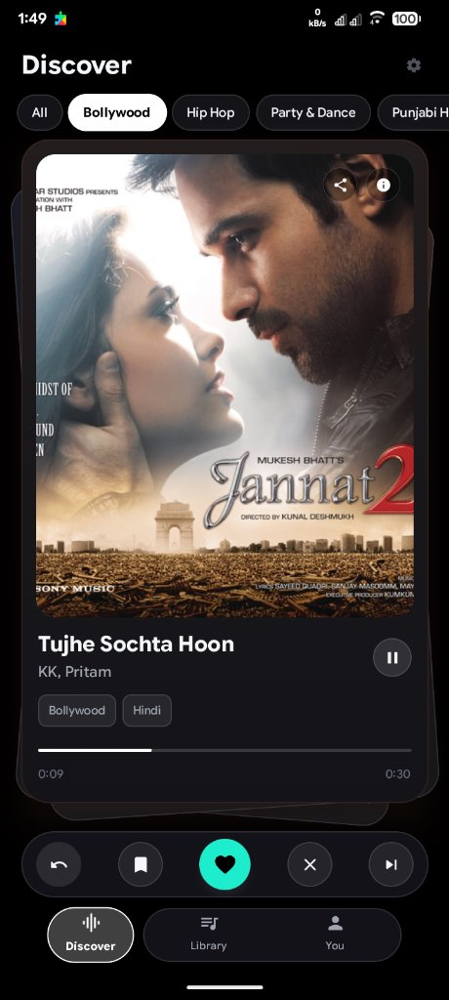
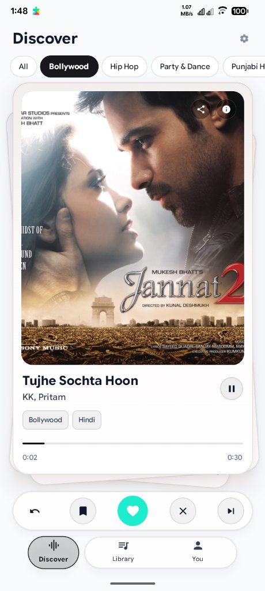
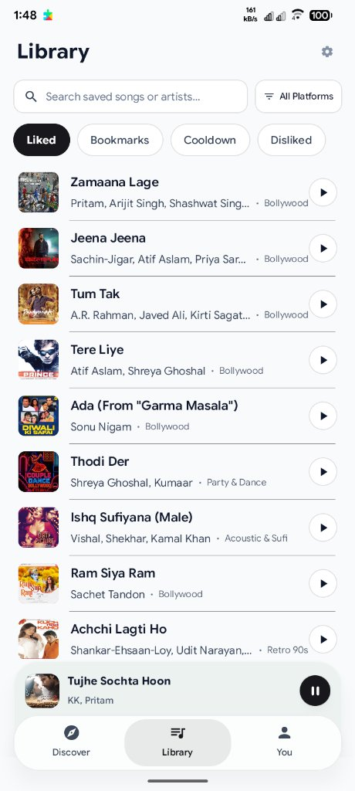

# Tunelyx

A native Android music discovery app built with Jetpack Compose and Media3. Tunelyx streams 30-second previews across multiple audio providers, builds a personal taste profile, and filters out the noise.

---

## Preview

<p align="center">
  
  
  
</p>

<p align="center">
  <em>Discover Deck (Pure AMOLED Dark) &nbsp;&bull;&nbsp; Discover Deck (Light Theme) &nbsp;&bull;&nbsp; Library &amp; Background Mini-Player</em>
</p>

---

## Features

- **Multi-Service Engine** — Resolves and streams previews across JioSaavn, YouTube Music, Deezer, and iTunes/Apple Music.
- **Taste Analytics** — Dynamic cubic bezier curves visualize your genre and artist affinities over a rolling 5-day window.
- **Audio Hygiene** — Suppresses low-effort edits (slowed+reverb, nightcore, sped-up) with toggleable filters for live cuts, acoustic tracks, and remixes.
- **Custom Blacklist** — Keyword-based track banning and blocked artist management.
- **AMOLED UI** — True `#000000` pitch black layout, adaptive immersive dock, and customizable accent colors.
- **Library Portability** — Non-destructive JSON export/import and plain-text (`Song - Artist`) track list parser.

---

## Build

### Prerequisites
- Android Studio Ladybug or newer
- JDK 17 or 21 (`JAVA_HOME`)
- Android SDK Platform 33+

### Commands

```bash
# Clone
git clone https://github.com/new-chandu/tunelyx.git
cd tunelyx

# Run unit tests
./gradlew testDebugUnitTest

# Build release APK
./gradlew assembleRelease
```

Output: `app/build/outputs/apk/release/app-release.apk`

---

## Architecture

- **UI:** Jetpack Compose, Material 3, Coil
- **Audio:** AndroidX Media3 (ExoPlayer) with pre-caching and crossfade
- **State:** MVI / MVVM with Coroutines & StateFlow
- **Storage:** SQLite (`TunelyxDbHelper`) + SharedPreferences
